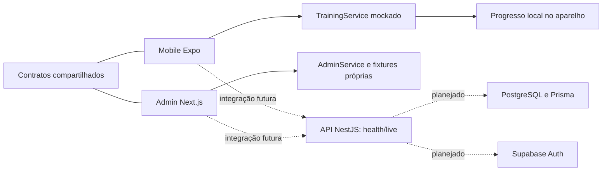

# AEX — Simulador Antifraude · Grupo G9

## 1. Apresentação do projeto

O AEX é um projeto acadêmico de prevenção de golpes e engenharia social, voltado principalmente a pessoas idosas. Propõe aprendizagem pela prática: reconhecer sinais de alerta, escolher como agir e receber explicações simples, sem culpabilizar quem já sofreu um golpe.

**Equipe atual:** Bruno, Abner e Túlio. **Supervisor registrado na proposta:** Prof. Paulo Cugnasca.

Este é o **README oficial e centralizado** do projeto. Reúne proposta acadêmica, evolução técnica, entregas e horas informadas. Os documentos específicos complementam este texto; o [README original](examples/prototype/README.md) permanece como fonte histórica preservada.

**Situação consolidada em 03/11/2026:** as seis etapas demonstrativas da Fase 4 estão presentes no código. O mobile oferece exercícios, feedback, progressão e persistência local; o admin apresenta fixtures próprias. A API NestJS continua limitada ao endpoint de saúde. Banco, autenticação e integração real não estão implementados. O bloqueio conhecido de typecheck mobile permanece: implementação presente não significa validação integral ou prontidão para produção.

## 2. Problema e justificativa

A proposta inicial, “Prevenção de golpes e engenharia social voltada a grupos vulneráveis”, descreve situações em que confiança, urgência, medo e pouca familiaridade digital favorecem decisões inseguras: um suposto familiar pede dinheiro, uma falsa central solicita códigos ou uma mensagem oferece benefícios por meio de um link.

A justificativa acadêmica é desenvolver autonomia e reflexão crítica por meio de simulações educativas, associando construção de software, inclusão digital e avaliação da compreensão. A KnowBe4 foi registrada como referência funcional de conscientização e gestão de treinamentos; o AEX tem escopo próprio e reduzido, sem reproduzir uma plataforma corporativa completa.

As simulações permanecem dentro da aplicação. Não enviam mensagens ou ligações reais, não executam ataques e não solicitam credenciais, transferências ou dados bancários. Endereços ilustrativos não são links para serviços reais.

## 3. Público-alvo

O público principal são pessoas idosas, com referência inicial em adultos de **60 anos ou mais**, especialmente quem utiliza celular para conversar, acessar serviços e realizar operações financeiras, mas tem menor familiaridade com solicitações suspeitas. Idade não determina habilidade digital: o projeto atende diferentes experiências, sem infantilização.

Necessidades consideradas: linguagem direta, textos legíveis, botões grandes, poucas decisões por vez, explicação de termos, repetição dos exercícios e orientação para conferir solicitações por outro canal. Contextos previstos: prática com familiares, oficinas de inclusão digital e instituições que atendem pessoas idosas, com participação voluntária e explicação prévia do caráter simulado.

Educadores, facilitadores, familiares e cuidadores compõem o público secundário. Os perfis abaixo são hipóteses da proposta, não resultados de entrevistas:

| Perfil de referência | Situação | Necessidade educativa |
| --- | --- | --- |
| Pessoa que usa principalmente mensagens | Suposto filho pede transferência de um número novo | Confirmar identidade pelo contato conhecido |
| Pessoa que utiliza serviços bancários | Suposta central solicita um código | Encerrar o contato e procurar um canal oficial |
| Facilitador de oficina | Grupo com experiências digitais diferentes | Selecionar temas e discutir dificuldades |

A documentação histórica menciona contato parcial em ambientes de estágio e intenção de incluir familiares. Não comprova validação com o público-alvo, consentimentos ou avaliação concluída.

## 4. Objetivos

**Objetivo geral:** apoiar o reconhecimento de golpes digitais e a escolha de atitudes seguras por meio de prática educativa acessível e acolhedora.

Objetivos específicos:

- Apresentar sinais de phishing e engenharia social em situações fictícias.
- Permitir decisões interativas e explicar por que uma atitude é mais segura.
- Incentivar aprendizagem sem punição, ranking ou obrigação diária.
- Registrar tentativas e conclusões, distinguindo aprendizagem de certificação de segurança.
- Oferecer aos facilitadores uma visão de participação e dificuldades; nesta fase, apenas demonstrativa.
- Preparar contratos e serviços para integração futura.
- Avaliar posteriormente usabilidade, compreensão do feedback e autonomia do público-alvo.

### Requisitos originais e evolução

Os critérios completos permanecem na [proposta acadêmica histórica](docs/projeto-academico.md). A mudança de arquitetura não elimina esses objetivos:

| Requisito original | Situação na evolução atual |
| --- | --- |
| RF01 — separar participante e administrador | Aplicações separadas; autorização administrativa ainda planejada |
| RF02 — configurar treinamento | Fluxo descrito no protótipo; criação/edição não implementada no novo admin |
| RF03 — apresentar simulação segura | Cenários fictícios, endereços ilustrativos e ausência de contatos externos |
| RF04 — receber decisão | Alternativas, confirmação e registro pelo mock |
| RF05 — explicar sinais de alerta | Feedback educativo e destaque da atitude segura |
| RF06 — registrar tentativa | Persistência local mobile; sem banco compartilhado |
| RF07 — exibir resultados | Histórico local; admin com dados fictícios independentes |
| RF08 — disponibilizar guia de incidentes | Requisito original; não implementado como seção própria no mobile atual |
| RF09 — repetir exercício | Nova tentativa no histórico, sem duplicar pontos pela conclusão |

Os requisitos não funcionais originais incluem adaptação a partir de 360 px, texto base de 18 px, controles de pelo menos 44 px, contraste conforme WCAG 2.2 AA, teclado, leitores de tela, linguagem sem culpa, privacidade e recuperação de falhas. São critérios de projeto, **não certificação de acessibilidade**. O mobile adota corpo de texto de 20 px e botões com altura mínima de 60 px. Verificações com pessoas idosas e tecnologias assistivas continuam pendentes.

## 5. Funcionamento da plataforma

### Participante

O participante acessa Início, Jornada, Atividades e Perfil. No módulo disponível, escolhe um dos três exercícios, lê o cenário, seleciona uma alternativa e confirma. O serviço demonstrativo avalia e salva a tentativa; após a explicação, **Continuar** salva a conclusão. Repetições geram histórico, mas cada exercício recebe pontos pela primeira conclusão apenas.

O progresso é recuperado do aparelho antes de liberar as telas. O perfil mostra conquistas, resumo e histórico. O nome exibido é de demonstração; não há conta autenticada. Os módulos sem exercícios estão em preparação.

### Administração

O admin possui Dashboard, Participantes, Simulações e Resultados, com busca, filtro, tabelas e gráficos. A indicação **Dados demonstrativos** é permanente. Seus participantes e respostas são fixtures, não dados coletados de usuários reais.

**Não existe sincronização mobile–admin.** Os arquivos locais do aplicativo não são lidos pelo painel. Compartilhar contratos TypeScript não compartilha dados, sessões ou resultados.

### Protótipo preservado

A primeira implementação é uma aplicação web em HTML, CSS e JavaScript, servida por Node.js, com `localStorage`. Demonstra participante/administração, configuração de um treinamento ativo e resultados locais, sem autenticação ou isolamento. Seus cenários incluem falso familiar, SMS suspeito e falsa central; o catálogo mobile posterior inclui SMS, link fraudulento e falsa central. A ligação é textual, sem áudio.

O modelo original distinguia Treinamento, Cenário e Tentativa, sem identificação pessoal. A evolução adicionou contratos de exercício, resultado e progresso; não criou ainda modelos persistentes de um backend.

## 6. Evolução, histórico e decisões

Inicialmente, o AEX foi desenvolvido como protótipo web. Posteriormente, evoluiu para uma fundação full-stack com aplicativo do participante, painel administrativo e API separados. Android/iOS estavam fora da primeira entrega e passaram ao desenvolvimento posterior, sem invalidar o contexto original.

| Marco verificável | Evidência | Leitura histórica |
| --- | --- | --- |
| 13/10/2026 — proposta e protótipo | `d985cc5`; README preservado | Primeira documentação acadêmica e protótipo |
| 21/10/2026 — checkpoint documental da fundação | `docs/validation.md` e `docs/versions.md` | Registro de validação com bloqueio mobile; não aprovação integral |
| 03/11/2026 — fundação registrada no Git | `68e710e`; merge `4ff23ff` | Monorepo e aplicações estruturadas |
| 03/11/2026 — interface, exercícios e animações | `c55deea` | Etapas 4.1 a 4.3 reunidas |
| 03/11/2026 — progressão | `60984f2` | Etapa 4.4 |
| 03/11/2026 — persistência e contratos | `d0294df` | Etapa 4.5 |
| 03/11/2026 — painel administrativo | `d0b8e2b` | Etapa 4.6 |

Datas de commits indicam registro das entregas, não início/fim do esforço nem horas individuais. A data do checkpoint documental difere da data de registro da fundação no Git; ambas foram preservadas sem inferir um cronograma não documentado.

### Decisões técnicas e conceituais

| Decisão sustentada pelos registros | Motivo e efeito |
| --- | --- |
| Preservar `examples/prototype` | Manter a primeira entrega executável e seu histórico; oito arquivos têm hashes de referência |
| Separar mobile e admin | Adequar prática e acompanhamento a públicos diferentes |
| Usar React Native/Expo e Next.js | Atender à evolução mobile e ao painel web na fundação aprovada |
| Adotar TypeScript, workspaces e pacotes compartilhados | Compartilhar contratos/configurações sem importar código de uma aplicação na outra |
| Reservar API NestJS centralizada | Concentrar futuramente avaliação confiável, autorização e dados; hoje só há liveness |
| Introduzir progressão educativa | Incentivar aprendizagem e conclusão, inclusive após erros, sem competição |
| Manter admin sóbrio | Apresentar indicadores e limites de interpretação sem gamificação visual |
| Começar com mocks | Desenvolver experiências e contratos antes da integração completa |

Não se inferem reuniões ou atribuições individuais. Documentos da Fase 3 reservavam “Fase 4” para banco e autenticação. A instrução posterior priorizou experiência e mocks: **o escopo desta fase substituiu aquele planejamento**, mantendo a infraestrutura como trabalho futuro.

## 7. Arquitetura e tecnologias

| Componente | Tecnologias registradas | Estado |
| --- | --- | --- |
| Participante | React Native 0.88.0, Expo 58.0.16, Expo Router 58.0.24, React 19.3.0, TypeScript | Implementado demonstrativamente; validação mobile parcial |
| Administração | Next.js 16.4.2, React 19.3.0, TypeScript | Dashboard demonstrativo implementado |
| API | NestJS 11.2.7 e TypeScript | Parcial: somente `GET /health/live` |
| Persistência mobile | `expo-file-system` 58.0.10; `localStorage` na prévia web | Local implementada; validação nativa em aparelho pendente |
| Contratos | `@aex/types`, incluindo `@aex/types/training` | Implementados e usados pelos clientes |
| Configuração/validação | `@aex/config`; `@aex/validation` com Zod | Base compartilhada; não valida ainda todos os futuros endpoints |
| Monorepo | npm workspaces, Turborepo 2.11.10, TypeScript 6.0.3 | Implementado; lockfile único |
| Banco | PostgreSQL e Prisma | Planejados; sem schema, migrations ou integração |
| Autenticação | Supabase Auth e autorização na API | Planejadas |
| Hospedagem | Vercel para admin, Render ou equivalente para API, Supabase para dados/Auth | Planejada; sem deploy comprovado nestas etapas |



Linhas tracejadas representam integrações planejadas. Não há conexão de dados entre armazenamento local e fixtures administrativas.

## 8. Estrutura do repositório

```text
README.md                    Documento oficial do projeto
apps/
  mobile/                    Expo: navegação, exercícios, feedback e progresso
    src/services/            Mock e adaptadores de armazenamento
    src/progression/         Cálculos e estado do progresso
    tests/                   Testes focados
  admin/                     Next.js: painel demonstrativo
    src/data/                Fixtures independentes
    src/services/            Serviço e agregações demonstrativas
    tests/                   Indicadores e filtros
  api/                       Fundação NestJS e Health
packages/
  types/                     Contratos públicos
  validation/                Validação compartilhada inicial
  config/                    TypeScript, ESLint e Prettier
examples/prototype/          Primeira entrega preservada
scripts/                     Verificação da preservação
docs/                        Histórico e referências técnicas
```

## 9. Fases e sprints do desenvolvimento

| Fase | Objetivo e atividades | Entregas/decisões sustentadas | Estado e pendências |
| --- | --- | --- | --- |
| 1 — análise do protótipo | Reconhecer limitações da primeira solução | README original registra dados por navegador, ausência de autenticação, treinamento único e chamada textual | **Não localizado relatório autônomo da Fase 1**; datas, horas e divisão do trabalho não documentadas; não se afirma auditoria concluída |
| 2 — planejamento | Definir arquitetura e migração | Documentos de arquitetura, banco e migração registram clientes separados, API, pacotes e preservação | Sem ata ou sprint autônoma da Fase 2 nos registros consultados; datas/horas a informar; integração planejada |
| 3 — fundação | Estruturar monorepo, apps mínimos e ferramentas | Workspaces, Turbo, Nest Health, Next/Expo iniciais e protótipo isolado | Checkpoint com builds/testes aprovados e typecheck mobile bloqueado; resolução não comprovada |
| 4 — experiência e admin | Implementar as seis etapas abaixo | Exercícios, feedback, progressão, persistência, contratos e painel mockado | Implementação demonstrativa registrada; infraestrutura e avaliação de uso real pendentes |

### Cronograma acadêmico original

| Período previsto em 2026 | Atividade planejada | Situação documental |
| --- | --- | --- |
| Outubro | Levantamento, público, requisitos, design e arquitetura | Proposta/protótipo e documentos disponíveis; validação com público não comprovada |
| Novembro | Desenvolvimento, conteúdo, estudos de caso e desafios periódicos | Fase 4 registrada; desafios periódicos não implementados como obrigação |
| Dezembro | Aplicação prática, usabilidade, métricas e relatório final | Planejado; execução e entrega a informar |

A metodologia documentada é incremental: especificação, protótipo, fundação, implementação por etapas e verificações focadas. A avaliação acadêmica prevista observa conclusão sem ajuda, compreensão do feedback e reconhecimento de canais seguros, sem tratar acertos como diagnóstico individual.

## 10. Fase 4 — experiência gamificada

As etapas foram confirmadas por consulta dirigida aos arquivos indicados. “Implementado” significa presente no código demonstrativo, não aprovado em produção ou em testes com pessoas idosas.

### 4.1 — Interface e navegação — implementada

- Identidade verde/creme, tipografia legível, cartões arredondados e botões amplos: [theme.ts](apps/mobile/src/theme.ts) e [ui.tsx](apps/mobile/src/components/ui.tsx).
- Início com saudação, recomendação, progresso e continuidade; Jornada, Atividades e Perfil nas [rotas de abas](apps/mobile/src/app/(tabs)).
- Navegação adaptável à largura e ampliação da fonte, áreas seguras e descrições acessíveis.
- A jornada apresenta quatro temas, mas apenas **Mensagens com cuidado** tem três exercícios disponíveis; os demais estão em preparação. Não há quatro módulos completos.

### 4.2 — Exercícios interativos — implementada

As [fixtures mobile](apps/mobile/src/data/exercises.ts) contêm **SMS suspeito**, **link fraudulento** e **falsa central bancária**. Cada exercício oferece introdução, cenário textual visual, pergunta, alternativas, confirmação, identificação de acerto/erro, explicação e conclusão.

O fluxo está em [ExercisePlayer.tsx](apps/mobile/src/components/exercises/ExercisePlayer.tsx). A avaliação demonstrativa é separada da apresentação e, após a etapa 4.5, solicitada pelo serviço mockado. Endereços `.invalid` e nomes fictícios não acionam serviços reais; não há captura de credenciais.

### 4.3 — Feedback visual — implementada, validação visual pendente

- “Muito bem!” no acerto e “Boa tentativa! Vamos aprender juntos.” no erro.
- Explicação e destaque textual da atitude segura, sem depender apenas de cores.
- Seleção com destaque gradual, check breve, transições de opacidade, preenchimento do progresso da atividade e celebração discreta com estrela.
- [Componentes de movimento](apps/mobile/src/components/exercises/motion.tsx) usam `Animated` e respeitam redução de movimento, inclusive mudanças durante o uso. Sem sons ou vibração obrigatória.

Não há evidência de validação dessas animações em aparelho/simulador ou de auditoria completa de acessibilidade.

### 4.4 — Progressão e recompensas — implementada

A [lógica de progressão](apps/mobile/src/progression/progression.ts) concede **10 pontos por exercício concluído**, uma única vez, independentemente de acerto. Repetições continuam disponíveis sem pontos adicionais; não há ranking nem exigência de sequência diária.

| Conquista | Condição |
| --- | --- |
| Primeiro passo | Concluir a primeira atividade |
| Olhar atento | Concluir uma atividade de phishing |
| Mais preparado | Concluir um módulo |

Existem barras por módulo, indicadores de conclusão, atualização do início/perfil e [tela de conclusão](apps/mobile/src/app/conclusao/[id].tsx). O resumo considera primeiras conclusões; o histórico posterior contabiliza todas as respostas. Pontos reconhecem aprendizagem e participação, **não desempenho confiável em segurança digital**.

### 4.5 — Persistência e contratos — implementada localmente

O [serviço mockado](apps/mobile/src/services/mockTrainingService.ts) fornece exercícios, registra respostas e conclui atividades. A confirmação persiste a tentativa; a conclusão é gravada após a explicação. Reenvios com o mesmo ID são idempotentes e gravações são sequenciais.

No Android/iOS, o [adaptador nativo](apps/mobile/src/services/progressStorage.ts) usa a área de documentos do app com `expo-file-system/legacy`; na prévia web, usa-se `localStorage`. A restauração precede as telas. Falhas de leitura ou formato desconhecido não substituem automaticamente o histórico; a interface permite tentar novamente.

O documento versionado contém IDs de tentativa/exercício/alternativa e datas de envio/conclusão, sem nome, texto livre, senhas ou dados bancários. Resultados e recompensas são reconstruídos pelo mock. Alterações futuras de catálogo/formato exigirão migração explícita; limpar os dados do app pode apagar o histórico.

| Contrato público | Finalidade |
| --- | --- |
| `Exercise` | Conteúdo público, sem gabarito |
| `ExerciseAttempt` | ID idempotente, exercício, alternativa e data |
| `ExerciseResult` | Resultado, explicação, conclusão e origem da avaliação |
| `TrainingProgress` | Histórico, conclusões, módulos, conquistas e resumo |
| `Achievement` | Descrição e estado de uma conquista |
| `ParticipantSummary` | Resumo e contagens por exercício |
| `TrainingService` | Fronteira assíncrona substituível por adaptador REST |

Os contratos estão em [training.ts](packages/types/src/training.ts). A avaliação usa `demonstrative`; a futura API deverá validar entradas e calcular resultados confiáveis, sem aceitar pontuação ou acerto declarados pelo cliente. A [referência mobile](apps/mobile/README.md) detalha métodos e possíveis endpoints, ainda não implementados.

### 4.6 — Painel administrativo — implementado com fixtures

| Página | Recursos presentes |
| --- | --- |
| `/` — Dashboard | Participantes, respostas, percentual de acertos, percurso concluído e gráficos |
| `/participantes` | Tabela fictícia, busca e filtro por situação |
| `/simulacoes` | Catálogo e cenários expansíveis |
| `/resultados` | Quantidades corretas/incorretas, percentuais e resumo por exercício |

A [base administrativa](apps/admin/src/data/adminFixtures.ts) possui **6 participantes fictícios, 3 simulações e 12 respostas: 7 corretas e 5 incorretas (58,3%)**. A taxa inclui repetições; conclusões contam uma vez por participante/exercício. Sem respostas, o percentual é “—”, não um acerto presumido ou divisão por zero.

A interface sóbria usa gráficos CSS e estados de carregamento, vazio e erro. [AdminService](apps/admin/src/services/adminService.ts) separa cálculos/dados das páginas e reutiliza contratos públicos. Todos os registros são ilustrativos e identificados como **Dados demonstrativos**. Não há integração real com mobile, autenticação, banco ou API de relatórios.

## 11. Como executar localmente

Ambiente de referência registrado: **Node.js 22.14.0 e npm 10.9.2**. Os manifests aceitam Node `>=22.14.0 <23` e npm `>=10.9.2 <11`. Os comandos abaixo são instruções para uso posterior; **não foram executados nesta consolidação documental**.

Na raiz, para preparar os workspaces:

```sh
npm ci
npm run build:packages
```

| Comando disponível na raiz | Aplicação |
| --- | --- |
| `npm start` ou `npm run dev:prototype` | Protótipo em `http://localhost:3000` |
| `npm run dev:mobile` | Expo/Metro; aparelho ou emulador compatível |
| `npm run dev:admin` | Admin em `http://localhost:3001` |
| `npm run dev:api` | API; `http://localhost:3002/health/live` |
| `npm run dev` | Apps do monorepo com acompanhamento/recompilação de pacotes; não inclui o protótipo |

O protótipo não exige instalação de dependências. `node examples/prototype/server.js` também o inicia diretamente. O README arquivado descreve comandos no contexto original; use os atalhos acima no monorepo atual.

No PowerShell, use `npm.cmd` se `npm.ps1` for bloqueado, sem alterar a política de execução. O simulador iOS exige macOS. Expo requer cliente compatível ou development build; exportar bundles não produz APK/IPA nem comprova funcionamento em aparelho.

Os `.env.example` reservam `NEXT_PUBLIC_API_URL` e `EXPO_PUBLIC_API_URL` para integração futura. A API usa `PORT` opcional, padrão 3002, e responde `{"status":"ok"}` no endpoint de saúde. Não são necessárias credenciais de banco/Auth para os mocks. Não inserir segredos em variáveis públicas. Detalhes em [development.md](docs/development.md).

## 12. Testes e validações registradas

Esta seção reúne **execuções anteriores**, não novas verificações. Não foram rodados instalação, build, lint, typecheck, testes ou auditoria de dependências nesta tarefa documental.

| Escopo / momento | Evidência de execução | Limite da conclusão |
| --- | --- | --- |
| Fundação — checkpoint de 21/10/2026 | `docs/validation.md`: 8/8 arquivos do protótipo preservados; 23 testes (6 protótipo, 15 schema, 2 HTTP); lint, builds e 20/20 checks Expo Doctor registrados como aprovados | Resultados históricos da fundação, não revalidação da Fase 4 |
| Mobile — etapas 4.2/4.3 | Registros das execuções desta sequência de desenvolvimento: 18 testes de exercícios e lint aprovados | Sem validação visual das animações em aparelho |
| Mobile — etapa 4.4 | 11 testes de progressão e lint aprovados | Cálculos/regras, não interação nativa completa |
| Mobile/contratos — etapa 4.5 | 14 testes de serviço, 11 de progressão e 18 de exercícios: **43** aprovados; lint mobile/types e typecheck de types aprovados | Recuperação simulada com armazenamento injetado; não teste de sistema de arquivos em aparelho |
| Admin — etapa 4.6 | **11** testes focados, typecheck e lint aprovados | Sem verificação visual no navegador registrada nessa etapa |
| Typecheck mobile | Continuou falhando nas dependências e em `test-types/dependencies.ts`; últimas verificações não apontaram erros novos no código alterado | Bloqueio não resolvido nem investigado nesta consolidação |

Os conjuntos de testes se sobrepõem: **não somar 18 + 11 + 43 como casos distintos**. Há 43 casos mobile e 11 admin nos registros finais das respectivas etapas; não foi executada nova suíte conjunta para certificar 54 casos na mesma revisão. As proveniências são explicitadas em [validation.md](docs/validation.md).

Comandos focados disponíveis para verificações futuras:

```sh
npm run test:exercises --workspace=@aex/mobile
npm run test:progression --workspace=@aex/mobile
npm run test:training --workspace=@aex/mobile
npm run test:admin --workspace=@aex/admin
npm run typecheck --workspace=@aex/mobile
npm run lint --workspace=@aex/mobile
npm run typecheck --workspace=@aex/admin
npm run lint --workspace=@aex/admin
npm run typecheck --workspace=@aex/types
npm run lint --workspace=@aex/types
```

`npm test` da raiz executa o protótipo e tarefas `test` do Turbo; não substitui os scripts específicos `test:exercises`, `test:progression`, `test:training` e `test:admin`. Os scripts gerais de build, formatação e preservação continuam disponíveis, sem execução nesta tarefa.

## 13. Equipe e horas de desenvolvimento

A equipe atual é exclusivamente **Bruno, Abner e Túlio**. Nomes completos nos documentos antigos foram mantidos nas fontes históricas, sem novas atribuições de autoria.

O único registro quantitativo localizado informa **2 horas por integrante em 12 a 18/10/2026**. O detalhamento individual continua a informar. A previsão acadêmica de **60 horas por pessoa, 180 horas da equipe**, não representa horas realizadas.

| Semana | Fase | Atividade / entrega documentada | Bruno (h) | Abner (h) | Túlio (h) | Total (h) |
| --- | --- | --- | --- | --- | --- | --- |
| 12–18/10/2026 | Proposta e protótipo | Público-alvo, especificação e primeira entrega web; distribuição individual a informar | 2 | 2 | 2 | 6 |
| A definir | 1 | Análise das limitações; registro autônomo a informar | A informar | A informar | A informar | A informar |
| A definir | 2 | Planejamento/migração; período a confirmar | A informar | A informar | A informar | A informar |
| A definir | 3 | Fundação/validação; checkpoint de 21/10 e commit de 03/11 não delimitam esforço semanal | A informar | A informar | A informar | A informar |
| 02–08/11/2026 (registro em 03/11) | 4.1–4.3 | Interface, exercícios e feedback; `c55deea` reúne as três etapas | A informar | A informar | A informar | A informar |
| 02–08/11/2026 (registro em 03/11) | 4.4 | Progressão; `60984f2` | A informar | A informar | A informar | A informar |
| 02–08/11/2026 (registro em 03/11) | 4.5 | Persistência e contratos; `d0294df` | A informar | A informar | A informar | A informar |
| 02–08/11/2026 (registro em 03/11) | 4.6 | Admin demonstrativo; `d0b8e2b` | A informar | A informar | A informar | A informar |
| A definir | Consolidação documental | README oficial e contexto dos registros | A informar | A informar | A informar | A informar |

A semana de registro da entrega não determina os dias efetivos de desenvolvimento. A equipe deverá distribuir horas pelas semanas trabalhadas, evitando contar novamente horas do protótipo nas Fases 1/2. Não foram estimadas horas por commits, autoria Git ou tempo de execução do Codex.

| Integrante | Total conhecido | Horas adicionais | Previsão acadêmica original |
| --- | --- | --- | --- |
| Bruno | 2 h | A informar | 60 h |
| Abner | 2 h | A informar | 60 h |
| Túlio | 2 h | A informar | 60 h |
| **Equipe** | **6 h conhecidas** | **A informar; não incluídas no total** | **180 h previstas** |

Fontes: [registro no README original](examples/prototype/README.md#5-registro-semanal-de-atividades-e-horas) e [registro histórico de horas](docs/registro-de-horas.md). Nenhum valor desconhecido foi tratado como zero.

### Modelo acumulativo para próximas sprints

Copiar o bloco ao registrar uma nova sprint, sem apagar fases anteriores:

```markdown
### Sprint [identificador] — [período a informar]

- Objetivo:
- Atividades realizadas:
- Entregas e evidências (arquivos, commits ou registros):
- Tecnologias envolvidas:
- Decisões tomadas e justificativas:
- Verificações efetivamente executadas e resultados:
- Pendências e próximos passos:

| Semana | Fase | Atividade | Bruno (h) | Abner (h) | Túlio (h) | Total conhecido (h) |
| --- | --- | --- | --- | --- | --- | --- |
| A definir | A informar | A informar | A informar | A informar | A informar | A informar |

Detalhamento individual e origem dos valores:
Totais acumulados conhecidos, sem somar horas pendentes:
```

## 14. Próximos passos

- Registrar períodos, horas, distribuição individual e entregas acadêmicas ainda não documentados, sem inferi-los do Git.
- Tratar o bloqueio mobile em tarefa técnica própria antes de declarar validação integral.
- Verificar interação, restauração e animações em aparelhos Android/iOS; revisar acessibilidade com tecnologias assistivas e pessoas idosas.
- Validar conteúdo e hipóteses de uso, documentando consentimento, compreensão e sugestões sem expor dados pessoais.
- Implementar API de negócio, avaliação autoritativa, banco/migrations e autenticação/autorização, conforme planejamento a revisar.
- Definir sincronização, versionamento de exercícios, migração de histórico e retenção. Dados demonstrativos locais não devem virar resultados confiáveis automaticamente.
- Evoluir módulos em preparação e requisitos não portados, como configuração de treinamentos e guia de incidentes.
- Reavaliar campanhas, áudio e exportação de relatórios, previstos originalmente e ainda não implementados.
- Planejar hospedagem e relatório final; não há comprovação de deploy ou piloto concluído.

## 15. Referências e documentação complementar

| Documento | Papel e preservação |
| --- | --- |
| [README do protótipo](examples/prototype/README.md) | Fonte histórica prioritária; protegido por hash em `scripts/verify-prototype.mjs`, mantido sem alteração, inclusive sem inserir links |
| [Proposta acadêmica](docs/projeto-academico.md) | Requisitos, público, modelo e planejamento da primeira entrega |
| [Registro de horas](docs/registro-de-horas.md) | Evidência dos valores informados; tabela atual centralizada neste README |
| [Arquitetura](docs/architecture.md) | Fundação e contexto da evolução posterior |
| [Desenvolvimento](docs/development.md) | Comandos e detalhes operacionais |
| [Migração](docs/migration-plan.md) | Plano histórico de preservação/recuperação da Fase 3 |
| [Banco planejado](docs/database.md) | Modelagem reservada à integração futura |
| [Validações](docs/validation.md) | Checkpoint histórico e execuções da Fase 4, sem revalidação documental |
| [Versões](docs/versions.md) | Matriz histórica de 21/10; não uma nova consulta ao registro de pacotes |
| [Referência mobile](apps/mobile/README.md) | Persistência, contratos e substituição do mock |
| [Referência admin](apps/admin/README.md) | Fixtures, cálculos e serviço administrativo |

A apresentação inicial é citada conforme as fontes históricas; não foi acrescentada cópia nem inventado link para ela. Nenhuma pesquisa externa foi realizada. READMEs técnicos são mantidos por utilidade específica; apenas este documento apresenta e acompanha o projeto de forma centralizada.
